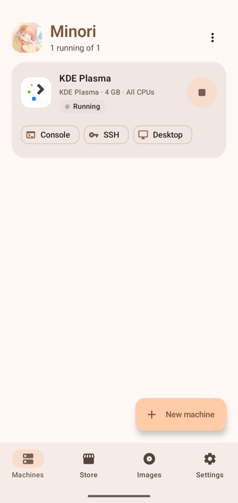
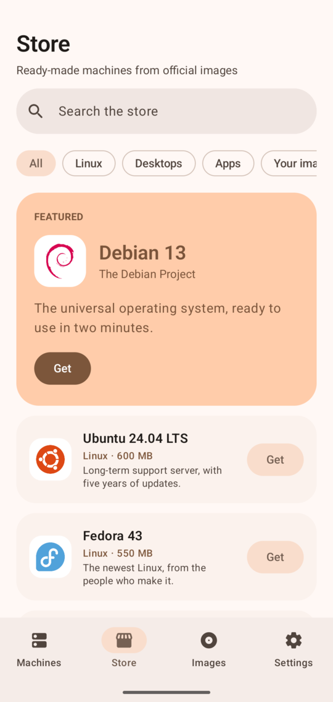
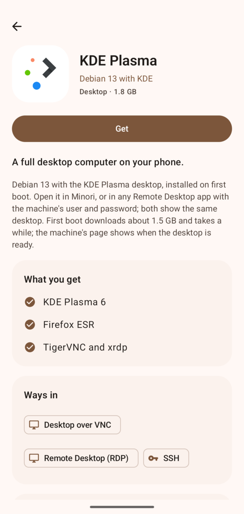
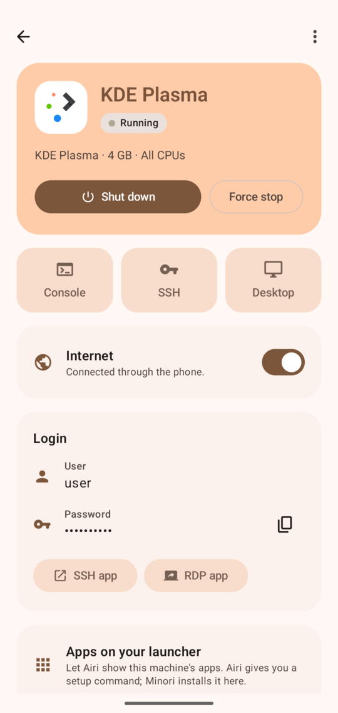
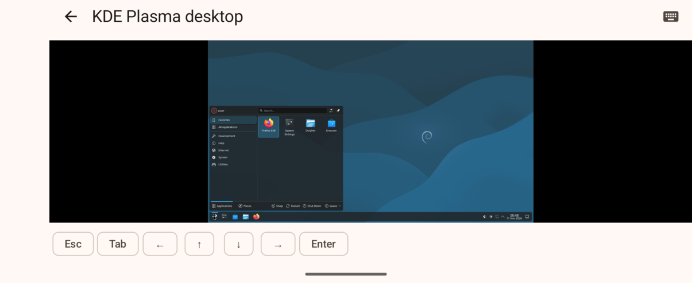

<p align="center">
  
</p>

<h1 align="center">Minori</h1>

<p align="center">Your Pixel's hypervisor.</p>

<p align="center">
  <a href="https://github.com/wonderhoy-labs/minori/actions/workflows/ci.yml"></a>
  <a href="LICENSE"></a>
  <a href="#license-and-credits"></a>
</p>

Minori runs virtual machines on your phone, with you in charge of them. Android's own Terminal app gives you one
Debian VM the way Google set it up; Minori lets you make as many as you like, from Debian, Ubuntu or Fedora cloud
images or your own disk images and ISOs, and choose their memory, CPUs, disks, ports and firewall. A serial
console, SSH and VNC are each one tap from the VM's page. It uses Android's Virtualization Framework (AVF), the
hypervisor Pixel phones have had since Android 14, and needs no root.

It's for people who want a real Linux machine in their pocket: to run servers, try distributions, or keep a
desktop VM around. Phones without AVF can keep Linux userlands through Termux instead, clearly labelled as not
being VMs.

<p align="center">
  
  
  
  
</p>
<p align="center"></p>
<p align="center"><sub>All on a Pixel 10 Pro, with Debian 13 and KDE Plasma running under AVF.</sub></p>

This is early software. It has run on one phone, a Pixel 10 Pro; Ubuntu, Fedora and much of the rest have only run
on the emulator against real guests. [What has been tested](#what-has-been-tested) says exactly what ran.

## What you need

- A phone with Android's Virtualization Framework: a Pixel 6 or newer on Android 14 or later. Minori checks, and says
  so if yours doesn't have it.
- Two permissions Android only grants through adb or Shizuku, once. Either:
  - [Shizuku](https://shizuku.rikka.app/) running, so Minori can grant them itself, or
  - a computer with [adb](https://developer.android.com/tools/adb) and USB debugging turned on.
- 64-bit Arm (`aarch64`, `arm64`) guests. A phone can't run x86-64 images or Windows.
- Space: a Debian VM takes about 1.2 GB to start with.
- For the Termux backend instead: [Termux](https://termux.dev) from F-Droid or its GitHub releases. Google Play's
  Termux is a different app that doesn't let other apps run commands, so Minori can't use it, and says so in Settings.

## Install

Download the APK from [Releases](https://github.com/wonderhoy-labs/minori/releases) and open it on your phone, or
install it with `adb`:

```bash
adb install -r minori-v0.2.1.apk
```

Then open Minori; its setup screen grants the two permissions virtual machines need, with Shizuku or a command for
`adb`. You can also [build it yourself](#development).

## Use it

### Give Minori its permissions

Open Minori. If Android hasn't granted its two AVF permissions, the setup screen opens and shows what's missing.

- **With Shizuku:** tap **Allow Minori in Shizuku**, accept Shizuku's prompt, then **Grant with Shizuku**. Android
  closes Minori for a moment when the permissions land, and Minori opens on the setup screen again.
- **With a computer:** run the two commands the screen shows, which you can copy from it:

```bash
adb shell pm grant com.wonderhoylabs.minori android.permission.USE_CUSTOM_VIRTUAL_MACHINE
```

```bash
adb shell pm grant com.wonderhoylabs.minori android.permission.MANAGE_VIRTUAL_MACHINE
```

Android closes Minori when the second one is granted. Open it again and it checks by itself.

### Make a machine

Tap **New machine** and pick a source:

- **Catalog:** Debian 13, Ubuntu 26.04 or 24.04 LTS or Fedora 43, downloaded from the project's own servers and checked
  against its published checksums. Or a desktop (KDE Plasma, Xfce or GNOME) or one app (Chromium, Firefox,
  LibreOffice, GIMP, Inkscape, Krita, Thunderbird, VLC or Blender), each built from Debian 13 on first boot.
- **Your images:** a raw disk, `.img`, qcow2 or ISO you imported. Minori looks inside first and tells you what it is,
  which CPU it's for and whether it can boot it.
- **Termux userland:** see below.

Choose the name, CPUs, memory and disk size. Minori suggests 2 GiB of memory on phones with 8 GiB or more and warns
past half of the phone's memory. AVF offers one virtual CPU or one per core, nothing in between. For cloud images,
Minori sets up a user, a password it shows you once, an SSH key and its guest agent on first boot, with cloud-init.

### Start, stop and connect

The machine's page has **Start**, **Shut down** (asks the guest to power off) and **Force stop**. Under
**Connect**:

- **Console:** the guest's serial console, kept open while the VM runs. Login shells on it learn the terminal's
  size, so `top` and `vim` fit the screen.
- **SSH:** logs in with the user and password or key Minori set up, through its own connection to the guest. You're
  asked to trust the guest's host key the first time.
- **VNC:** the guest's desktop, if it runs a VNC server. Tap to click, long-press to right-click, drag to move.
- **RDP** and **SSH in another app:** open your RDP or SSH app on a port Minori publishes on the phone for it.

### Publish ports and set the firewall

Under **Network**, **Publish a port** makes a guest port reachable on the phone: TCP or UDP, a phone port of 1024
or more, and either this phone only (127.0.0.1) or its networks too. Each port can have an allow list and a deny
list of addresses or ranges such as `192.168.1.0/24`; deny always wins. Nothing is published until you add it, and
the page shows each port's state and how many connections it served or refused.

### Disks, images, import and export

- **Images** lists what you imported, with its format, size, SHA-256, CPU and what Minori found inside.
- **Edit** a stopped machine to change its CPUs and memory, grow a disk, add an empty disk or attach an image,
  choose which disk it boots from, and change the kernel command line. A Termux machine has only its name, login and
  notes to change.
- **Export** writes a `.minorivm` archive anywhere the system's file picker can save; **Import a .minorivm archive** on
  the main screen brings one back. The format is in [docs/archive.md](docs/archive.md).
- **Clone** copies a machine, disks and all. **Delete** asks whether to keep its disks in Images. Deleting the last
  Termux machine of a distribution offers to remove that distribution from Termux too.

### Without a hypervisor: Termux

On a phone without AVF, a **Termux userland** is a Debian, Ubuntu, Arch, Alpine or Fedora installed by Termux's
proot-distro, with an SSH server that Minori's console logs in to. Allow Minori in Termux first:

```bash
mkdir -p ~/.termux && echo 'allow-external-apps = true' >> ~/.termux/termux.properties
```

proot-distro's own Arch is x86-64 only, so Arch comes from Arch Linux ARM's aarch64 root filesystem, checked against its build system's signing key. It shares the phone's kernel and network; it's not a VM, and Minori labels it **Termux** everywhere.
Airi can show a Termux machine's apps too, apart from Alpine's, whose musl Airi's agent doesn't run on.

A Debian or Ubuntu Termux machine can have a **desktop**: **Add a desktop** on its page installs Xfce, TigerVNC and
xrdp, about 500 MB. It's one session that Minori's **Desktop** and Asahi show over VNC, and that Remote Desktop apps on
the phone reach with **RDP app**, logging in with the first 8 characters of the machine's password. Both listen on
the phone's loopback only, on ports of the machine's own, and start and stop with the machine. A desktop needs
**Disable child process restrictions** on in Developer options, or Android stops it.

### Android's own terminal through your VPN

Minori's machines reach the internet through Minori's own sockets, so they follow whatever VPN the phone uses: Saki,
Akiyama, Shira or any other. Android's Linux terminal doesn't. Android connects it by tethering, which never goes
through a VPN app, so with Wi-Fi and mobile data off it has no internet even while Saki, Akiyama or Shira works.

**Settings → Android's terminal** fixes that. Tap **Set up**, then **Copy and open the terminal**, paste the command
and press Enter. It installs Minori's guest agent in the terminal's Linux as a system service. When Android asks about
port 5741, tap **Allow**. Then turn the card's switch on. The terminal's traffic now goes through Minori, and through
the phone's VPN if there is one, until you turn it off. While the switch is on, Minori keeps running with a
notification. How it works is in [docs/agent.md](docs/agent.md#androids-terminal).

## Use it in your app

Minori has three ways in.

**`minori-core`, the Rust library** that does Minori's image work: inspect an image and find its kernel, convert qcow2 to a
sparse raw disk, extract a bootable kernel and initrd, write cloud-init seeds, and pack or unpack `.minorivm`
archives. Add it by the release tag:

```toml
minori-core = { git = "https://github.com/wonderhoy-labs/minori", tag = "v0.2.1" }
```

```rust
let report = minori_core::inspect::inspect(Path::new("debian.qcow2"))?;
if let Some(plan) = &report.boot {
	let files = minori_core::boot::extract(Path::new("debian.qcow2"), plan, Path::new("boot"))?;
	println!("{} with {}", files.kernel.display(), files.cmdline);
}
```

Its main entry points are `inspect::inspect`, `boot::extract`, `convert::to_raw`, `convert::grow`,
`seed::write_nocloud` with `seed::CloudConfig`, and `archive::export` and `archive::import`.
`crates/minori-core/examples/in_process.rs` runs them together. The `minori` command-line tool is the same thing on a
computer (`minori inspect`, `convert`, `boot`, `seed`, `export`, `import`).

**`@wonderhoy-labs/minori`, the TypeScript library**, for a web page or tool on a computer that reaches the phone over
adb, such as Asahi. It talks to Minori's helper socket (`localabstract:minori`, which answers only adb and root): list
machines, start and stop them, read their ports, and open a guest port, the console or the desktop. Its VNC client
draws a machine's desktop on a canvas, with mouse and keyboard. It has no dependencies; add it by the release's URL:

```json
"@wonderhoy-labs/minori": "https://github.com/wonderhoy-labs/minori/releases/download/v0.2.1/wonderhoy-labs-minori-0.2.1.tgz"
```

```ts
import { bindInput, canvasTarget, Minori, VncClient, WAKE_COMMAND } from "@wonderhoy-labs/minori";

// `adb` is Tango's Adb, or anything with createSocket(service). Wake Minori if it isn't running.
await adb.subprocess.noneProtocol.spawnWaitText(WAKE_COMMAND);
const minori = Minori.overAdb(adb);
const [machine] = await minori.list();
await minori.start(machine.id);
const desktop = await minori.desktop(machine.id);
const client = await VncClient.connect(await minori.connect(machine.id, desktop.port), canvasTarget(canvas), desktop.password);
bindInput(canvas, client);
```

Its main entry points are `Minori` (`hello`, `list`, `start`, `stop`, `ports`, `desktop`, `connect`, `console`),
`VncClient` with `canvasTarget` and `bindInput`, and `WAKE_COMMAND`, which starts Minori without opening it on the
phone. `node tools/minori-client.ts` tries the same protocol from a terminal, after
`adb forward tcp:5742 localabstract:minori`.

**Links:** `minori://vm/<id or name>`, and `/console`, `/ssh` or `/vnc` after it, open a machine's page or screen.
They never start anything. `minori://vm/<id or name>/app/<desktop file ID>` opens one Linux app from a machine
through Airi, like Airi's own `airi://app/<desktop file ID>`, and starts the machine if it has to. The machine needs
Airi set up in it.

The helper protocol and the links are in [docs/asahi-integration.md](docs/asahi-integration.md).

**Airi** (0.4.0 and later) lists the Linux apps in Minori's machines next to Android's terminal's, and reaches them
through Minori's `content://com.wonderhoylabs.minori.airi` provider, never through a port on the phone, so both work
at once. It covers virtual machines with Minori's guest agent and Termux userlands with glibc. Only Airi and `adb` may
use the provider. The contract is in [docs/airi.md](docs/airi.md).

## What has been tested

On an Apple M5 Mac (macOS 27.0.1) with Android Emulator 37.2.13 and Docker Desktop, and on the maintainer's Pixel 10
Pro (Android 17, `CP3A.260905.009`, user build). The emulator can't run AVF, so it tested everything around it with the
debug build's demo backend pointed at real guests: Debian 13 in QEMU, and Debian 13 containers with systemd.

| What                                                                                              | Where                                       | Result |
| ------------------------------------------------------------------------------------------------- | ------------------------------------------- | ------ |
| `cargo test --workspace` (19 tests), Clippy, rustfmt                                              | Mac                                         | Pass   |
| `:app:testDebugUnitTest` (38 tests), Spotless, `:app:lintRelease`                                 | Mac                                         | Pass   |
| `@wonderhoy-labs/minori` (13 tests: DES vectors, the helper protocol, a VNC session against a fake server) | Mac                              | Pass   |
| Inspect Debian 13's official arm64 cloud image (qcow2); qcow2 to raw                              | Mac and the emulator                        | Found GPT, ext4, kernel and initrd; byte-identical to `qemu-img` |
| Kernel, initrd and seed Minori made, booted                                                       | QEMU 10 `virt`, TCG, in Docker              | Debian 13 booted, cloud-init applied the seed, SSH logged in |
| Store: search, categories, item pages, real logos; machines, images and settings tabs             | Emulator, Android 17 (`CE2A.260420.051.A2`) | Looked at |
| Import an image through the file picker, make a machine, console, SSH, VNC, published ports with allow and deny rules, export, import, clone, delete | Same | Pass |
| **Internet for the guest**: a Debian 13 guest whose only route was Minori's `minori0`, `curl https://deb.debian.org` | QEMU guest, through the emulator's app | HTTP 200; a 15 MB download at 3.9 MB/s through the test rig |
| KDE Plasma and Chromium store items: the exact first-boot commands Minori generates            | Debian 13 containers with systemd           | Plasma and Chromium came up on VNC after install and after a reboot |
| Xfce, GNOME and GIMP store items, the same way                                                    | Debian 13 arm64 containers with systemd     | All three came up on VNC: Xfce's desktop, GNOME Shell, and GIMP 3.0.4 filling its desktop. Not after a reboot, and not on a phone |
| Every package the other app items install (Firefox, LibreOffice, Inkscape, Krita, Thunderbird, VLC, Blender) | Debian 13 arm64, a dry-run install | All found. The apps themselves weren't started |
| Remote Desktop to KDE: FreeRDP through Minori's forwarded port and the agent                     | Same, with the emulator's app               | Logged in with the machine's password and showed the same desktop; a wrong password was refused |
| Airi: "Apps on your launcher" with Airi 0.2.0 from its release                                    | Emulator, a Debian 13 guest container       | Airi listed the guest's apps and opened Foot in a window |
| **Airi 0.4.0 through Minori's provider**, at the same time as a stand-in for Android's terminal on 47821: list, open Calculator and type in it, Foot from the terminal beside it, a launcher app for the machine's Calculator that starts the stopped machine, `minori://vm/…/app/foot.desktop`, and Airi's **Set up in Minori** opening the setup | Emulator (`Airi_Test_API_37`), demo backend on `minori-agent --tcp` and `airi-agent` in Debian 13 arm64 containers | Pass |
| **Airi in a Termux machine**: Set up in Minori, Start and install (first start installed Debian with proot-distro), Foot in an Airi window, stop and start bringing the agent back on its own port | Emulator, Termux 0.118.3 (GitHub build) | Pass after a fix: the first try gave up waiting while Termux was still installing Debian |
| **Airi through Minori on AVF**: Airi's Set up in Minori, Start and install in the Xfce machine, its apps listed beside the Terminal's, Mousepad from Xfce and the Terminal's Calculator open at once | Pixel 10 Pro, 0.4.0 and Airi 0.4.0 release builds | Pass after a fix: setup tried SSH before the guest agent was up |
| Xwayland for Airi: setup's install command in the Xfce machine, which had none; the agent restarted and ran Xwayland | Pixel 10 Pro | Pass |
| Termux: check, the refusal when `allow-external-apps` is off, a Debian userland with its console  | Emulator, Termux 0.118.3                    | Pass   |
| Helper and library: wake without opening Minori, list, start, ports, desktop, VNC login, wrong password refused | Emulator, Node 24 on the Mac       | Pass   |
| Asahi with Minori as a source: a machine's desktop with keyboard and mouse, its console, back to the Pixel | Emulator, Asahi's dev server       | Pass   |
| AVF: Debian 13 boots, console login, the agent comes up from cloud-init, SSH over vsock           | Pixel 10 Pro                                | Pass   |
| **KDE Plasma from the store on AVF**: download, first boot, internet through Minori (apt fetched about 1,400 packages over HTTPS), desktop ready in about 14 minutes | Pixel 10 Pro, on Wi-Fi | Pass |
| That machine's desktop over VNC, and Remote Desktop with FreeRDP, both through Minori's helper and agent | Pixel 10 Pro, from the Mac over adb | Plasma's desktop with the right date and time |
| Minori's own desktop viewer on that machine: picture, taps, KDE's menu, sideways                  | Pixel 10 Pro                                | Pass after a fix; 0.1.0's viewer closed at once with "Operation not supported on transport endpoint" |
| **Xfce from the store**, 0.2.0's release build: download, first boot, internet through Minori, Xfce in Minori's viewer | Pixel 10 Pro, on Wi-Fi | Pass; setup finished in about 5 minutes |
| Asahi with Minori as a source: the Xfce machine's desktop with a mouse, and its console | Pixel 10 Pro, Asahi's dev server in Chrome | Pass |
| **Android's terminal through Minori**, 0.3.0 built locally with the release key: Set up, the install command in the terminal, Android's port 5741 allowed, the switch on | Pixel 10 Pro, the terminal's Debian | The agent answered only with the token; `minori0` became the default route |
| The terminal with Wi-Fi and mobile data off, Shira as the VPN (from Asahi's dev server on the Mac) | Same | `curl https://deb.debian.org` 200, 10 MB at 1.7 MB/s, public IP the Mac's network. With the switch off: "Could not resolve host" |
| The terminal with Wi-Fi and mobile data off, Akiyama as the VPN (`akiyama server --adb` on the Mac) | Same | 200, 10 MB at 2.0 MB/s, the Mac's public IP. With the switch off: no DNS, no connection |
| The Xfce machine with Wi-Fi and mobile data off, Akiyama as the VPN, `curl` over Minori's SSH | Pixel 10 Pro | The Mac's public IP, deb.debian.org 200, 10 MB at 223 KB/s |
| The terminal with Wi-Fi and mobile data off, Saki as the VPN (`saki server` on the Mac, over Bluetooth) | Pixel 10 Pro, the terminal's Debian | The Mac's public IP, deb.debian.org 200; 4.9 MB at 55 KB/s before the test's 90-second limit |
| The Xfce machine with Wi-Fi and mobile data off, Saki as the VPN | Pixel 10 Pro | The Mac's public IP, 2 MB at 54 KB/s |
| Termux with Google Play's Termux (`googleplay.2026.10.09`) installed: Settings explains it and links to F-Droid | Pixel 10 Pro | Pass; 0.2.0's **Allow Minori to use Termux** did nothing |
| **Termux on the Pixel** with F-Droid's Termux 0.118.3: Check Termux, a Debian 13 userland from **Linux in Termux** (first start about 3 minutes), its console, `apt-get install mousepad` | Pixel 10 Pro, 0.4.1 | Pass |
| Airi in that Termux machine: Set up in Minori, Mousepad listed and opened in an Airi window, typing | Pixel 10 Pro, 0.4.1 and Airi 0.4.1 | Pass |
| Asahi's console for that machine at the tab's size, and after the tab shrank | Pixel 10 Pro, 0.5.0 and Asahi 0.4.2 through its development server | Pass; before 0.5.0 it kept the 52 columns of Minori's own console |
| **Desktop in a Termux machine**: Add a desktop, Xfce in Minori's viewer, FreeRDP logging in to the same session over RDP | Pixel 10 Pro, 0.6.0; FreeRDP 3 in a Debian 13 container on the Mac through `adb forward` | Pass |
| Arch Linux in Termux | Pixel 10 Pro, 0.6.0 | Refused by proot-distro: no arm64 image. 0.6.1 marked it unavailable |
| **End-to-end run for 0.7.0**, built with the release key: a Debian 13 machine from a downloaded image (online 15 s after Start), console, in-app SSH with the host key prompt, SSH from the Mac through a published port, allow and deny lists over Wi-Fi | Pixel 10 Pro, Android 17 | Pass after three fixes: finished connections stayed open, an edited port could stop listening, and ports on the network needed Android 17's local network permission |
| Edit: name, memory, one CPU, start at boot, growing the disk from 8 to 10 GB and adding a 1 GB disk, all seen inside; shut down, force stop, clone, export (409 MB in 20 s), import, delete keeping the disks | Same | Pass |
| ISOs: an x86-64 one refused with the reason; Alpine's aarch64 virt ISO booted from its own kernel | Same | Pass |
| Store: Ubuntu 24.04, **Ubuntu 26.04**, Fedora 43 and GNOME made, booted, online, SSH and HTTPS; GNOME over RDP with FreeRDP | Same | Pass; Ubuntu 26.04 after a fix, since its kernel is wrapped in a systemd-stub program |
| Fedora 45 | Same | No kernel found: it's only in the Btrfs root. The store stays on Fedora 43 |
| **Termux**: Ubuntu, Alpine, Fedora and Arch Linux ARM machines started at once, each online, consoles through the helper | Pixel 10 Pro, F-Droid Termux 0.118.3 | Pass |
| A desktop in the Ubuntu 26.04 Termux machine: install (about 4 minutes), Xfce in Minori's viewer, FreeRDP to the same session | Same | Pass after fixes: the backdrop was black, and with four Termux machines running, Android's limit of 32 child processes killed the desktop and three SSH servers |
| Airi in the GNOME machine: Set up in Minori (8 s), GNOME's apps listed, Text Editor in an Airi window with typing; `minori://vm/GNOME/app/org.gnome.TextEditor.desktop` starting the stopped machine and opening it (about 40 s) | Pixel 10 Pro, Airi 0.4.1 | Pass |
| **Firefox from the store**: made from the downloaded image in seconds, first boot in about 3 minutes, Firefox in Minori's viewer loading example.com | Same | Pass after a fix: the viewer's taps and keys never reached a Termux machine's desktop, since they were written on the main thread |
| RDP app with Microsoft's Windows App on the Firefox machine | Same | The app opened on 127.0.0.1 and showed the machine's certificate; not signed in, since accepting the certificate was left to the owner |
| GNOME (4 GB) and Firefox (3 GB) running at once | Same | Android swapped until Minori stopped responding. Since 0.7.0 Minori asks before starting a machine that needs more memory than is free |
| Deleting Termux machines with **Remove … from Termux**: Termux ran `proot-distro remove` for Ubuntu, Alpine, Fedora and Arch | Pixel 10 Pro | Pass |
| Android's terminal through Minori, 0.7.0 | Same | Default route `minori0`, `curl https://deb.debian.org/debian/` HTTP/2 200 |
| The helper as Asahi uses it: hello, list, ports, a stream to the Firefox machine's SSH, its desktop | Pixel 10 Pro, `tools/minori-client.ts` on the Mac | Pass. Asahi itself wasn't run again: its setup would have replaced the phone's VPN |
| Minori noticing a Termux machine whose SSH server was killed; Edit for a Termux machine; the notifications prompt on the first start; Discard on Edit's back | Emulator (`Minori_Test_API_37`), F-Droid Termux 0.118.3 | Pass |
| **Arch Linux ARM in Termux**, 0.6.2: download, signature check, install, pacman keyring and openssh, console (`Arch Linux ARM`, `aarch64`); first setup in the background without Display over other apps | Emulator (`Airi_Test_API_37`, arm64), F-Droid Termux 0.118.3 | Pass |

**Never run:**

- The Xfce machine through Shira with Wi-Fi off: Shira's page went away before that run.
- IPv6 through the terminal's link: the agent only routes IPv4, and the terminal had no IPv6 route to leak through.

- The app items other than Firefox on a phone.
- Signing in with RDP and SSH apps on the phone itself; FreeRDP on the Mac signed in through the same forwarded port.
- A Termux desktop with Android's child process limit turned off. With it on, Android kills the desktop.
- Auto-start at boot, which needs the phone restarted.
- Refusing a non-adb app on the helper socket. Minori checks the peer's uid, but no other app tried.

## How it works

### The hypervisor

AVF runs crosvm, started by Android's virtualization service, which boots a Linux kernel with its disks as virtio
block devices. There's no PC firmware, so Minori finds the guest's kernel itself: it reads the image's partitions and
ext4 filesystem in Rust, takes the newest `/boot/vmlinuz-*` and its initrd, unpacks it to a raw arm64 kernel, and
builds the command line from the image's own boot loader settings. Custom kernels are hidden API on Android 17;
Minori exempts that one package for its own process. More in [docs/avf.md](docs/avf.md).

### Disks and images

Every VM disk is a raw, sparse file in Minori's private storage, so it takes only the space the guest writes and grows
with a `truncate`. qcow2 images are converted on import, and ISOs are attached read-only. Minori knows where Debian, Ubuntu, Fedora and
Alpine ISOs keep their installer kernels and boots those; only Alpine's has been tried, under QEMU.

### First boot

For cloud images Minori writes a small FAT disk labelled `CIDATA` that cloud-init reads: the hostname, a user with a
password and an SSH key, `openssh-server`, Minori's guest agent and its systemd unit, and a login snippet that asks the
terminal its size.

### Ports and the guest agent

A published port is a listening socket in Minori's process. Each connection is checked against the port's allow and
deny lists, then joined to a connection into the guest: over vsock to `minori-agent`, which connects the guest port on
its own loopback. SSH and VNC in the app use the same path without publishing anything. The agent's protocol is in
[docs/agent.md](docs/agent.md).

### Backends

`AvfHypervisor` runs VMs, `TermuxHypervisor` runs proot userlands through Termux's `RUN_COMMAND` intent with SSH as
the console, and `DemoHypervisor` (debug builds only) stands in for a hypervisor with a shell on the phone. They
share one interface, so the rest of the app doesn't care which one runs a machine.

## Security and privacy

- **What Minori can reach:** its own storage, the files you pick, and the network for catalog downloads (only each
  project's official servers) and for ports you publish. It sends nothing anywhere else and has no analytics.
- **Guests** are unprotected AVF VMs: the Android side can read their memory and disks, which is what lets you
  manage them. They can't reach Android, except through ports you publish to them and through AVF's network if you
  turn it on.
- **Published ports** listen on 127.0.0.1 unless you choose the network. Any app on the phone can connect to a
  127.0.0.1 port, so protect services with their own passwords, or use the allow and deny lists. A port open to the
  network can be reached by anyone on the same Wi-Fi.
- **The helper socket** answers only adb's shell user and root, by the uid Android reports. Anyone with adb access to
  your phone can already do far more.
- **Hidden API:** Minori exempts `android.system.virtualmachine` from Android's hidden API checks, in its own process
  only. It doesn't change any system setting.
- **Secrets:** passwords and SSH keys stay in Minori's private storage. Exports leave them out unless you tick the box.
- The Shizuku helper only runs `pm grant` for Minori's own two permissions, then `am start` to reopen Minori.

## Troubleshooting

**"Allow Minori to use Termux" does nothing,** in 0.2.0. Your Termux is probably Google Play's, which doesn't have the
permission Minori asks for, so Android skips the request. Since 0.2.1 Settings says so. Minori needs Termux from F-Droid
or its GitHub releases; uninstall the Play one first, which deletes what's in it.

**"This device doesn't have Android's Virtualization Framework."** Minori needs a phone with AVF, such as a Pixel 6 or
newer on Android 14 or later. Emulators don't have it. Use the Termux backend instead.

**Minori closed while I granted the permissions.** That's Android: granting `MANAGE_VIRTUAL_MACHINE` restarts the app.
Open Minori again.

**"Shizuku is installed but Minori can't reach it."** Start Shizuku in its app. If it's running already, close Minori and
open it again, so it gets Shizuku's connection.

**An image says "Won't run here: it's for x86-64 PCs."** Download the ARM64 (`aarch64`) version of that image.

**An ISO says no kernel was found.** Minori knows the installer kernels of Debian, Ubuntu, Fedora and Alpine ISOs. For
others, use the distribution's ARM64 cloud image.

**A published port says it's already in use.** Another app or port uses that phone port; pick another above 1024.

**Published ports never connect.** They need Minori's guest agent, which machines made with first-boot setup have. Check
`systemctl status minori-agent` in the guest.

**A Termux machine stops on its own, or its desktop goes black.** Android stops Termux's processes once there are more
than 32, which several Termux machines or one desktop go past. Turn on **Disable child process restrictions** in
Developer options; Settings has a button that opens them.

**Other devices can't reach a port published to the network.** On Android 17 Minori needs the local network permission
for that, and asks when you publish one. If you refused, allow it in Android's settings for Minori.

**`top` or `vim` doesn't fit the console.** Run `resize-console` after turning the phone; serial consoles can't tell
the guest the size by themselves.

## Known issues

- Fedora 44 and later keep their kernel only in a Btrfs root, which Minori can't read yet, so the store offers 43.
- Android stops an app's child processes past 32 until **Disable child process restrictions** is on in Developer
  options. A few Termux machines, or one with a desktop, go past that; Minori says so where it matters.
- **Listening in the guest** also lists services that listen on the guest's own loopback only, which a published port
  can't reach.
- AVF only offers one virtual CPU or one per core.
- Resizing the terminal doesn't reflow lines already printed.
- The VNC viewer only speaks raw and copy-rect updates, fine over Minori's own connection but heavy over a network.
- Keys sent far faster than anyone types, such as `adb shell input text`, can arrive scrambled in the VNC viewer.

## Development

| Path                  | What                                                                     |
| --------------------- | ------------------------------------------------------------------------ |
| `crates/minori-core/`    | The library: images, kernels, archives, seeds                            |
| `crates/minori/`         | The command-line tool                                                    |
| `crates/minori-jni/`     | The library and pseudo-terminals for the Android app                     |
| `crates/minori-agent/`   | The guest agent                                                          |
| `android/app/`        | The Android app                                                          |
| `android/avf-stubs/`  | Compile-only stubs of AVF's system API                                   |
| `tools/`              | `theme.ts`, `unify.ts`, and `minori-client.ts`, a stand-in for Asahi        |
| `docs/`               | Design notes and screenshots                                             |

You need Node 24 and pnpm, a Rust toolchain with the targets `aarch64-linux-android`, `armv7-linux-androideabi`,
`x86_64-linux-android` and `aarch64-unknown-linux-musl`, `cargo-ndk`, and the Android SDK with platform 37 and NDK
30.

```bash
pnpm install && pnpm unify && pnpm lint && pnpm typecheck
```

```bash
cargo fmt --all && cargo clippy --workspace --all-targets -- -D warnings && cargo test --workspace
```

```bash
cd android && ./gradlew spotlessApply :app:testDebugUnitTest :app:lintRelease :app:assembleRelease
```

To release: bump `VERSION` and the Cargo workspace version, update [What has been tested](#what-has-been-tested),
then tag `v<VERSION>` and push both. CI builds, signs and publishes.

## Under the hood

- [docs/avf.md](docs/avf.md): AVF's API on Android 17, its permissions, and how Minori builds a VM
- [docs/agent.md](docs/agent.md): the guest agent and its protocol
- [docs/archive.md](docs/archive.md): the `.minorivm` format
- [docs/asahi-integration.md](docs/asahi-integration.md): the helper socket, links, and the plan for Asahi and Airi
- [docs/airi.md](docs/airi.md): how Airi lists and reaches the Linux apps in Minori's machines
- [docs/roadmap.md](docs/roadmap.md): the versions, and what's next

## License and credits

Minori is a [Wonderhoy Labs](https://github.com/wonderhoy-labs) project, released under the
[Apache License 2.0](LICENSE). It isn't affiliated with Google. Android and Pixel are trademarks of Google LLC.

It stands on the work of these projects:
- [Android's Virtualization Framework and crosvm](https://source.android.com/docs/core/virtualization) (Apache 2.0),
  which run the VMs
- [Jetpack Compose and AndroidX](https://developer.android.com/jetpack) (Apache 2.0), for the app
- [Shizuku](https://github.com/RikkaApps/Shizuku) (Apache 2.0), for granting permissions without a computer
- [AndroidHiddenApiBypass](https://github.com/LSPosed/AndroidHiddenApiBypass) (Apache 2.0), for AVF's custom-image
  API
- [JSch, mwiede's fork](https://github.com/mwiede/jsch) (BSD), the SSH client
- [kotlinx.serialization](https://github.com/Kotlin/kotlinx.serialization) and
  [kotlinx.coroutines](https://github.com/Kotlin/kotlinx.coroutines) (Apache 2.0)
- [ext4-view](https://github.com/nicholasbishop/ext4-view-rs) (Apache 2.0 or MIT), which reads guest filesystems
- [rust-fatfs](https://github.com/rafalh/rust-fatfs) (MIT), for cloud-init seeds and EFI partitions
- [ruzstd](https://github.com/KillingSpark/zstd-rs) (MIT), for zstd-compressed kernels and qcow2 clusters
- [flate2](https://github.com/rust-lang/flate2-rs), [tar](https://github.com/alexcrichton/tar-rs), [sha2](https://github.com/RustCrypto/hashes),
  [serde](https://github.com/serde-rs/serde), [jni](https://github.com/jni-rs/jni-rs) and
  [libc](https://github.com/rust-lang/libc) (MIT or Apache 2.0)
- [cloud-init](https://github.com/canonical/cloud-init) (Apache 2.0 or GPL 3), which sets up guests on first boot
- [Debian](https://www.debian.org), [Ubuntu](https://ubuntu.com) and [Fedora](https://fedoraproject.org), whose
  official cloud images the catalog downloads
- [Biome](https://github.com/biomejs/biome) (MIT or Apache 2.0) and [Spotless](https://github.com/diffplug/spotless)
  (Apache 2.0), which keep everything formatted

Minori is named for Hanasato Minori of MORE MORE JUMP!, from Project SEKAI COLORFUL STAGE! feat. Hatsune Miku.
Wonderhoy Labs is a fan project, not affiliated with SEGA, Colorful Palette or Crypton Future Media, who own Project
SEKAI and its characters. The Apache License doesn't cover the Minori name or logo.
